

  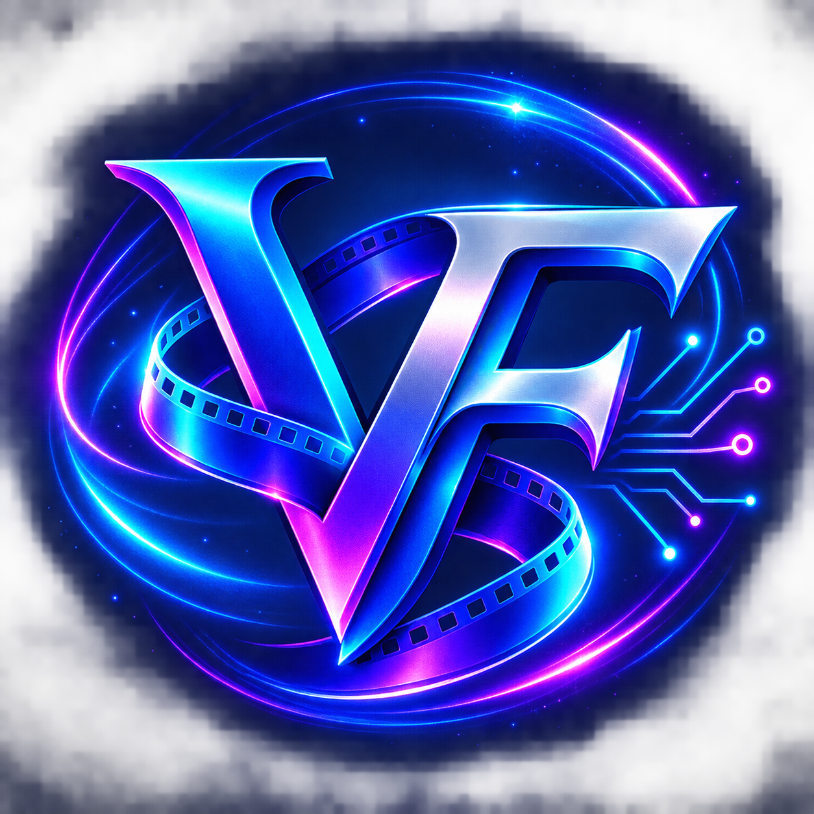

<h1 align="center">VitaeFluxum</h1>

<strong>De tu idea a la imagen y al vídeo, paso a paso.</strong>

Guiones · Personajes · Blueprints · Storyboards · Prompts de vídeo · Guía visual

<a href="INSTALACION.md">Instalación</a> · <a href="plugins/vitaefluxum/skills/vitaefluxum/references/bienvenida.md">Por dónde empezar</a> · <a href="plugins/vitaefluxum/skills/vitaefluxum/references/catalogo-blueprints.md">Ver blueprints</a> · <a href="plugins/vitaefluxum/skills/vitaefluxum/references/guia-visual.md">Guía visual</a>

## ¿Qué es VitaeFluxum?

VitaeFluxum es un complemento gratuito con instrucciones, documentación y plantillas para desarrollar proyectos audiovisuales con inteligencia artificial. Te ayuda a convertir una idea en una historia, diseñar sus personajes y escenarios y preparar las imágenes y los prompts de vídeo con continuidad visual.

**No necesitas saber de cámaras ni escribir prompts.** Puedes pedir que te guíe paso a paso o trabajar directamente en una parte de tu proyecto. Si ya tienes imágenes, un guion o un storyboard, puedes empezar desde ahí.

Las explicaciones se adaptan al idioma en el que hables con el asistente. Los ejemplos visuales no llevan rótulos incrustados: cada imagen acompaña al concepto que se está explicando.

## Empieza con una conversación

Después de instalarlo, abre un chat nuevo, activa VitaeFluxum y escribe, por ejemplo:

> Quiero crear un vídeo, pero no sé por dónde empezar. Guíame paso a paso.

También puedes pedir algo concreto:

- «Enséñame los tipos de blueprint para elegir uno».
- «Tengo esta imagen: ayúdame a preparar un storyboard».
- «Prepara un prompt de vídeo con timeline para la plataforma que voy a usar».
- «Explícame qué es un plano cenital y muéstrame un ejemplo».

[Ver las siete opciones de inicio](plugins/vitaefluxum/skills/vitaefluxum/references/bienvenida.md)

## Personajes y objetos que mantienen su identidad

Los blueprints reúnen las referencias de rostro, cuerpo, vestuario y objetos para mantener su aspecto entre imágenes y planos. Puedes elegir el formato y pedir **solo el prompt, solo la imagen o ambos**. La creación de imágenes depende de las herramientas disponibles en tu asistente.

<table>
<tr>
<td align="center" width="33%"><a href="plugins/vitaefluxum/skills/vitaefluxum/references/blueprints/rostro.md">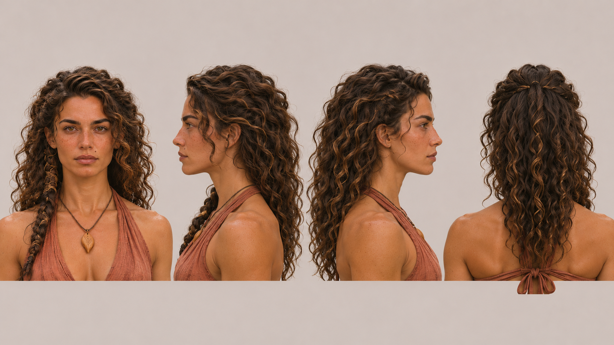</a> <strong>Rostro</strong></td>
<td align="center" width="33%"><a href="plugins/vitaefluxum/skills/vitaefluxum/references/blueprints/personaje-completo.md">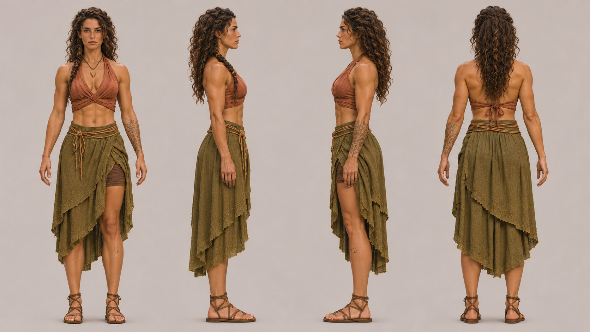</a> <strong>Personaje completo</strong></td>
<td align="center" width="33%"><a href="plugins/vitaefluxum/skills/vitaefluxum/references/blueprints/ficha-compacta.md">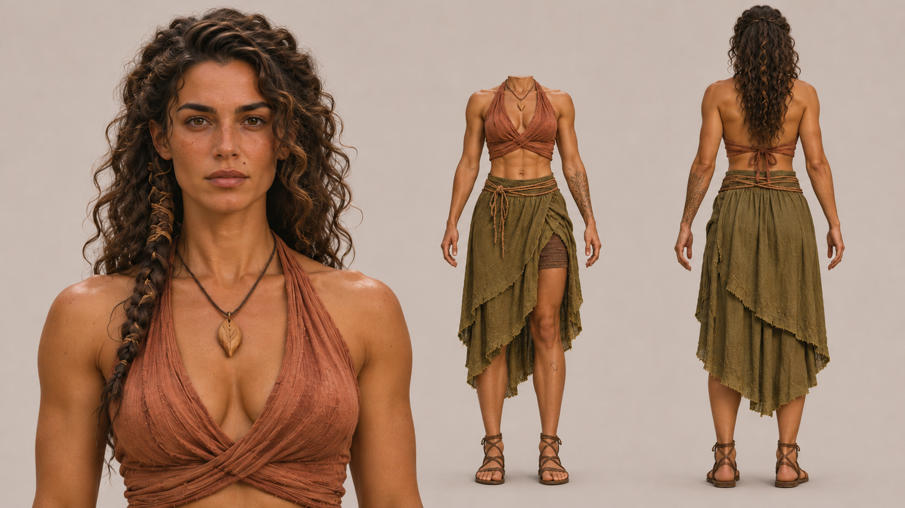</a> <strong>Ficha compacta</strong></td>
</tr>
</table>

También hay referencias para objetos, desde una espada o un mueble hasta un vehículo.

<table>
<tr>
<td align="center" width="33%"><a href="plugins/vitaefluxum/skills/vitaefluxum/references/blueprints/objeto-espada.md">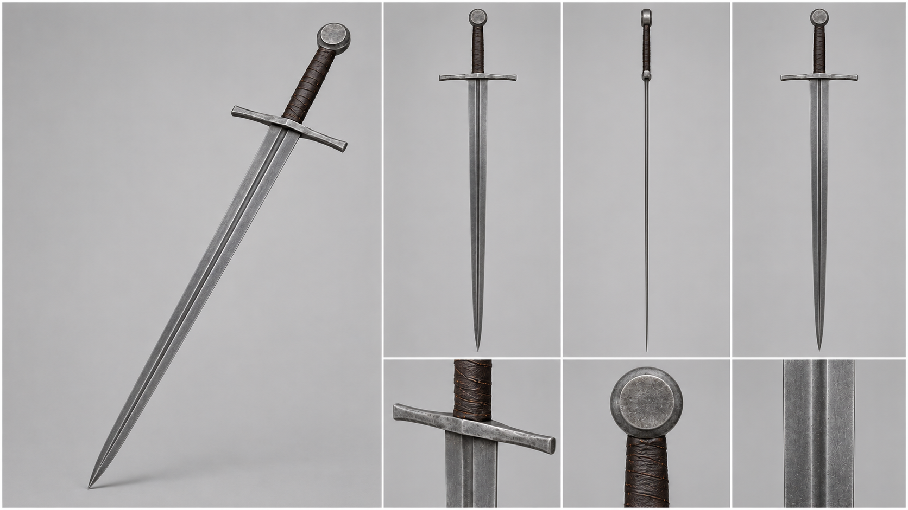</a> <strong>Espada</strong></td>
<td align="center" width="33%"><a href="plugins/vitaefluxum/skills/vitaefluxum/references/blueprints/objeto-mueble.md">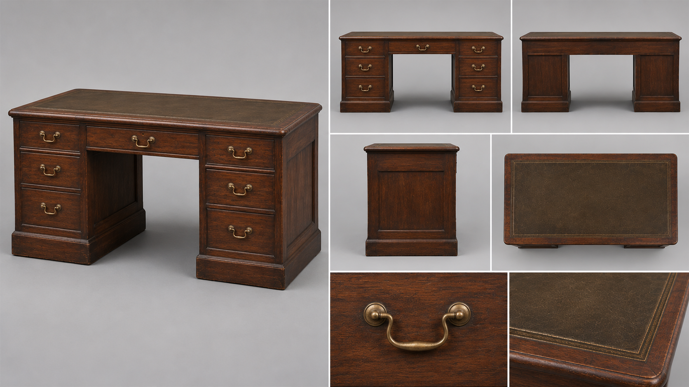</a> <strong>Mueble</strong></td>
<td align="center" width="33%"><a href="plugins/vitaefluxum/skills/vitaefluxum/references/blueprints/objeto-vehiculo.md">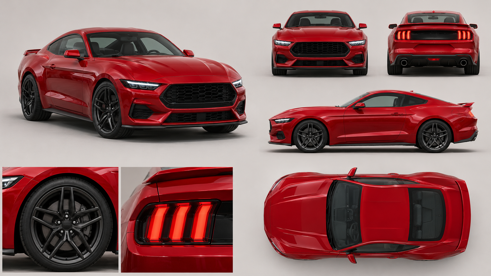</a> <strong>Deportivo moderno</strong></td>
</tr>
</table>

[Explorar los ocho formatos y sus prompts base](plugins/vitaefluxum/skills/vitaefluxum/references/catalogo-blueprints.md)

## Una guía visual para entender el cine

Consulta planos, ángulos, composición, lentes, profundidad de campo, iluminación y color con **39 imágenes de referencia**. Puedes aprender un concepto y aplicarlo a tu escena en la misma conversación.

<table>
<tr>
<td align="center" width="33%"> <strong>Primer plano</strong></td>
<td align="center" width="33%"><a href="plugins/vitaefluxum/skills/vitaefluxum/references/guia/02-angulos.md">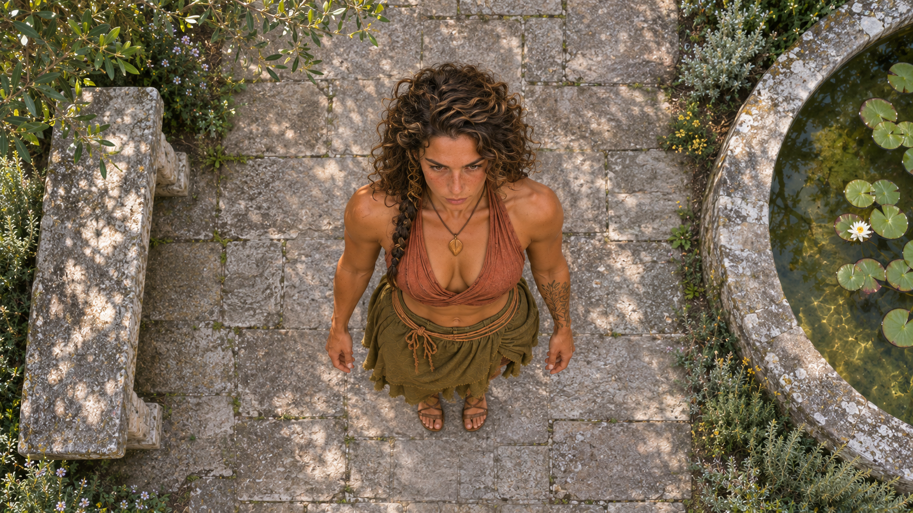</a> <strong>Ángulo cenital</strong></td>
<td align="center" width="33%"> <strong>Composición por tercios</strong></td>
</tr>
</table>

<table>
<tr>
<td align="center" width="33%"> <strong>Profundidad de campo</strong></td>
<td align="center" width="33%"> <strong>Luz lateral</strong></td>
<td align="center" width="33%"><a href="plugins/vitaefluxum/skills/vitaefluxum/references/guia/05-luz-color.md">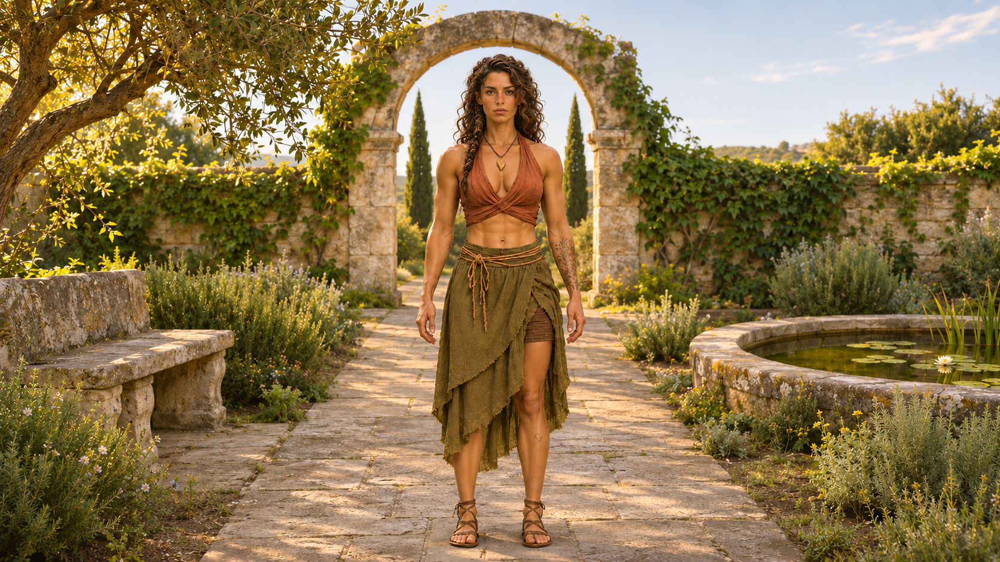</a> <strong>Color cálido</strong></td>
</tr>
</table>

También incluye explicaciones sobre cámaras, movimientos y continuidad. Los movimientos de cámara se explican con texto; una imagen fija no muestra su recorrido. Los ejemplos de lentes son ilustrativos, no comparaciones ópticas calibradas.

[Abrir la guía visual de cine y vídeo](plugins/vitaefluxum/skills/vitaefluxum/references/guia-visual.md)

## Prompts de vídeo para tu plataforma

Antes de preparar el prompt, VitaeFluxum identifica **qué plataforma vas a usar, la duración y cómo se llaman tus referencias**. Así puede separar qué aporta cada imagen o vídeo: identidad, escenario, aspecto, acción o cámara.

| Plataforma | Plantilla |
| --- | --- |
| Grok | [Prompt base y referencias](plugins/vitaefluxum/skills/vitaefluxum/references/video-grok.md) |
| Higgsfield | [Prompt base y referencias](plugins/vitaefluxum/skills/vitaefluxum/references/video-higgsfield.md) |
| OpenArt | [Prompt base y referencias](plugins/vitaefluxum/skills/vitaefluxum/references/video-openart.md) |
| Google Flow | [Prompt base y referencias](plugins/vitaefluxum/skills/vitaefluxum/references/video-flow.md) |

Los prompts organizan la acción en un **timeline**: planos, cambios de cámara, gestos, miradas, pausas, diálogo y sonido cuando corresponda. Se adaptan a las funciones disponibles en el modelo y modo elegidos; no todas las plataformas interpretan las referencias ni reproducen los movimientos del mismo modo.

[Cómo funcionan las referencias y las plataformas](plugins/vitaefluxum/skills/vitaefluxum/references/video-plataformas.md)

## Blender: una previsualización opcional

Después de aprobar la imagen base de una escena, puedes preparar una referencia en Blender para planificar posiciones, acciones y cámara antes de generar el vídeo. También puedes continuar directamente con el prompt.

**Elige cuánto detalle necesitas para explicar la acción:**

<table>
<tr>
<td align="center" width="33%"><a href="plugins/vitaefluxum/skills/vitaefluxum/references/blender-opcional.md">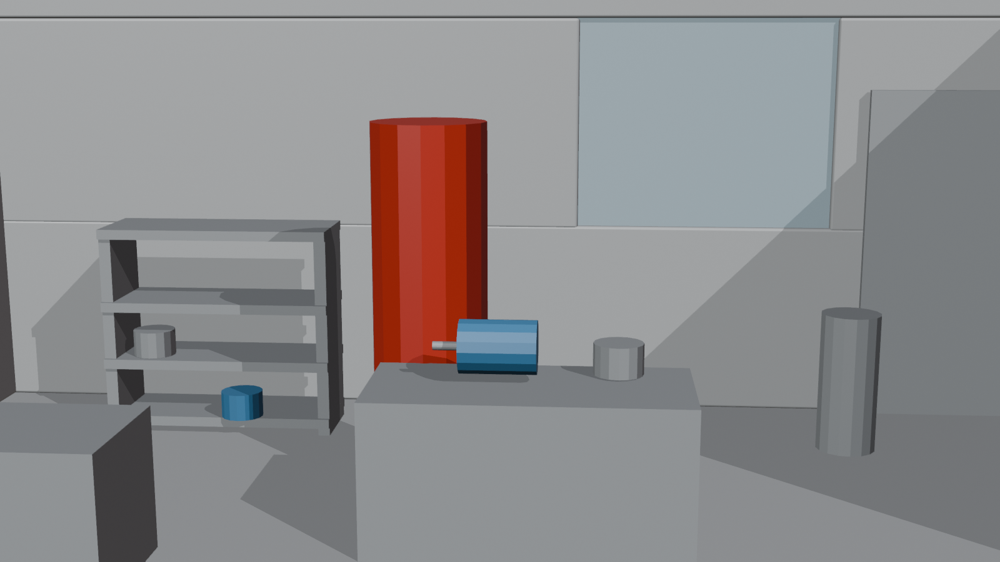</a> <strong>Volúmenes de colores</strong></td>
<td align="center" width="33%"><a href="plugins/vitaefluxum/skills/vitaefluxum/references/blender-opcional.md">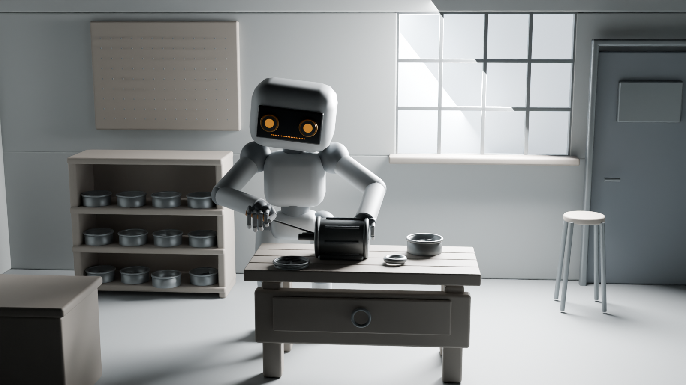</a> <strong>Maniquí articulado</strong></td>
<td align="center" width="33%"><a href="plugins/vitaefluxum/skills/vitaefluxum/references/blender-opcional.md">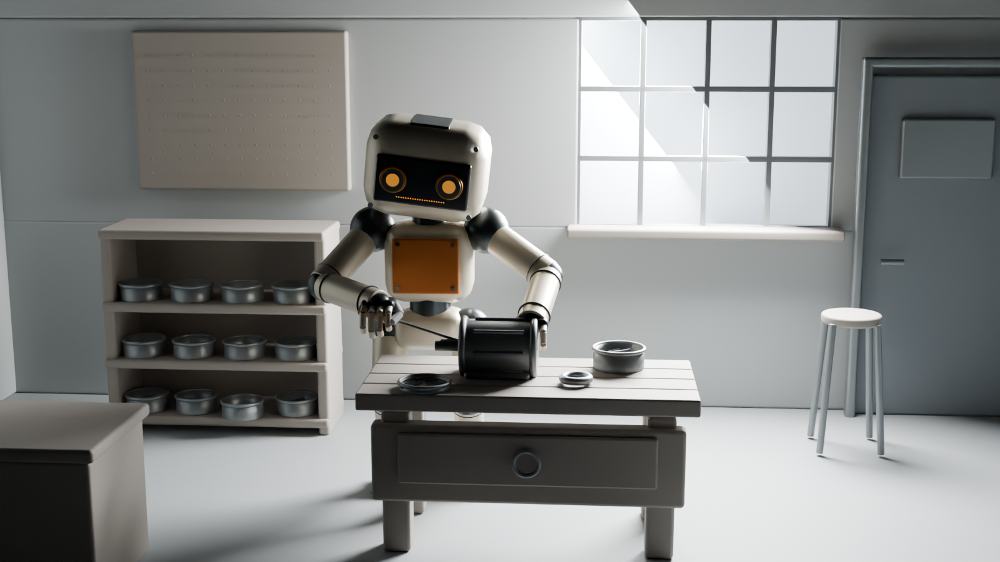</a> <strong>Modelo detallado</strong></td>
</tr>
</table>

**El acabado visual se elige por separado:**

<table>
<tr>
<td align="center" width="33%"><a href="plugins/vitaefluxum/skills/vitaefluxum/references/blender-opcional.md">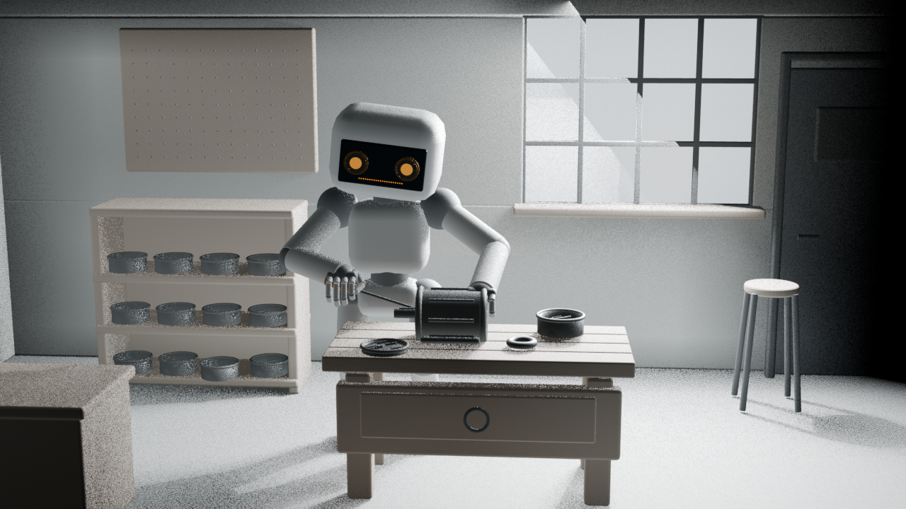</a> <strong>Rápido</strong></td>
<td align="center" width="33%"><a href="plugins/vitaefluxum/skills/vitaefluxum/references/blender-opcional.md">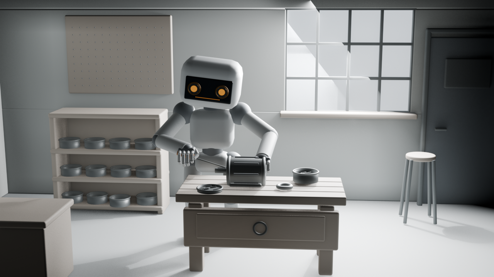</a> <strong>Intermedio</strong></td>
<td align="center" width="33%"><a href="plugins/vitaefluxum/skills/vitaefluxum/references/blender-opcional.md">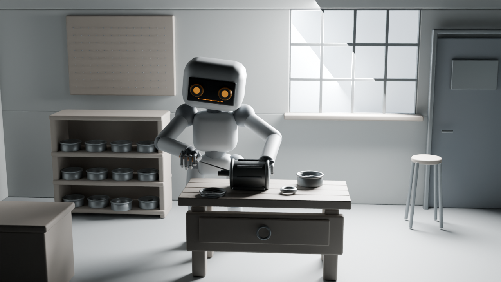</a> <strong>Alto</strong></td>
</tr>
</table>

Primero se revisa un render estático y, después de aprobarlo, se prepara la animación cuando haga falta. Una representación sencilla puede bastar para comunicar el movimiento; los tiempos y el consumo dependen de la escena, las herramientas y las revisiones.

La ejecución requiere acceso a Blender. Usar el MP4 como referencia depende de que el generador y el modo elegidos lo admitan; subir un vídeo no garantiza que se copie su movimiento.

[Ver el proceso de previsualización](plugins/vitaefluxum/skills/vitaefluxum/references/blender-opcional.md)

## Un proyecto completo, o solo la ayuda que necesitas

**Idea y guion → personajes y objetos → escenarios → storyboard → imagen de escena → Blender opcional → prompt de vídeo.**

Puedes detenerte en cualquier etapa, revisar lo que ya tienes o consultar la guía visual cuando lo necesites. El objetivo es mantener la identidad, el vestuario, la anatomía, las posiciones y la continuidad entre planos.

[Consultar el flujo de trabajo](plugins/vitaefluxum/skills/vitaefluxum/references/flujo-proyecto.md)

## Instalación y actualización

Este repositorio incluye el complemento y una skill con sus imágenes y documentación. La carpeta de la skill está en `plugins/vitaefluxum/skills/vitaefluxum`.

Usa el mecanismo de instalación que admita tu aplicación, incluido Claude cuando disponga de importación de skills compatible. Conserva **la carpeta completa**, con sus referencias e imágenes: copiar únicamente `SKILL.md` no incluye todo el material.

Generar imágenes o ejecutar Blender requiere que el asistente disponga de esas herramientas. No necesitas una habilidad privada del creador. La disponibilidad y el procedimiento de instalación dependen de la aplicación y la cuenta.

[Instrucciones de instalación y actualización](INSTALACION.md) · [Portabilidad entre asistentes](plugins/vitaefluxum/skills/vitaefluxum/references/portabilidad.md)

## Novedades de la versión 2

- Inicio guiado para quien todavía no sabe cómo comenzar.
- Ocho formatos de blueprint con sus ejemplos y plantillas.
- Guía visual con 39 imágenes individuales.
- Prompts de vídeo por plataforma, con timeline y referencias.
- Previsualización opcional en Blender con distintos niveles de representación y acabado.

La versión anterior se conserva en el historial del repositorio. La instalación y el comportamiento no se han probado en todos los asistentes.

[Ver los cambios](CAMBIOS-V2.md) · [Estado de las comprobaciones](REVISION.md)
