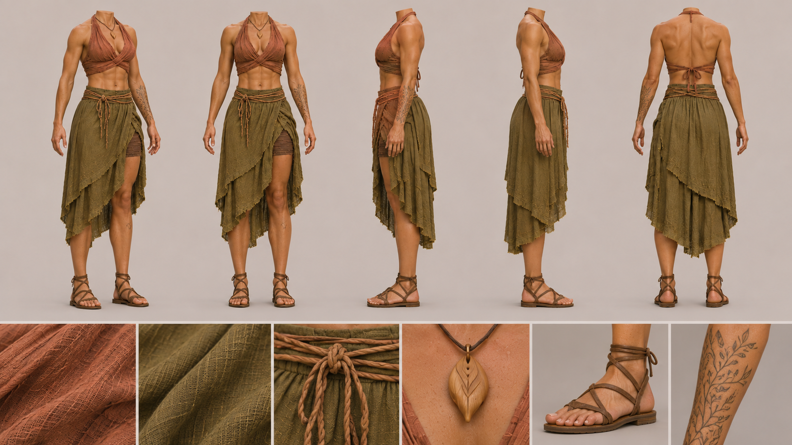
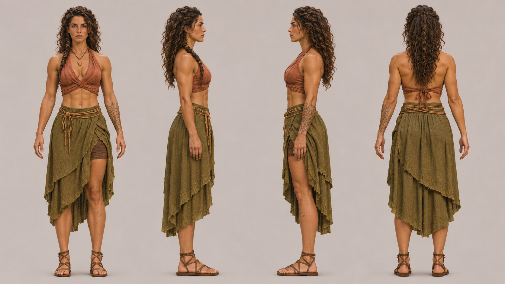
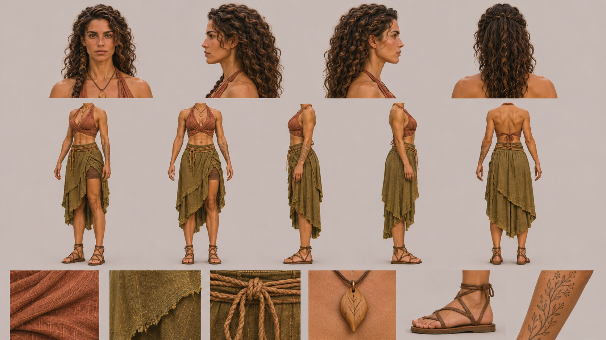
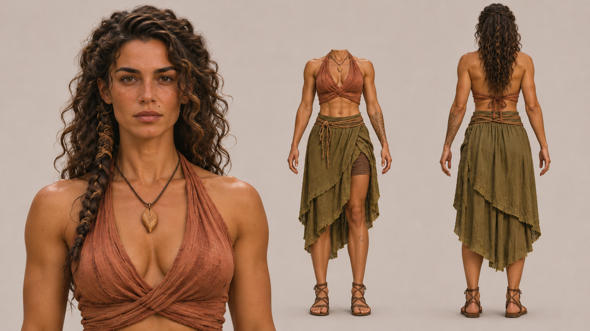
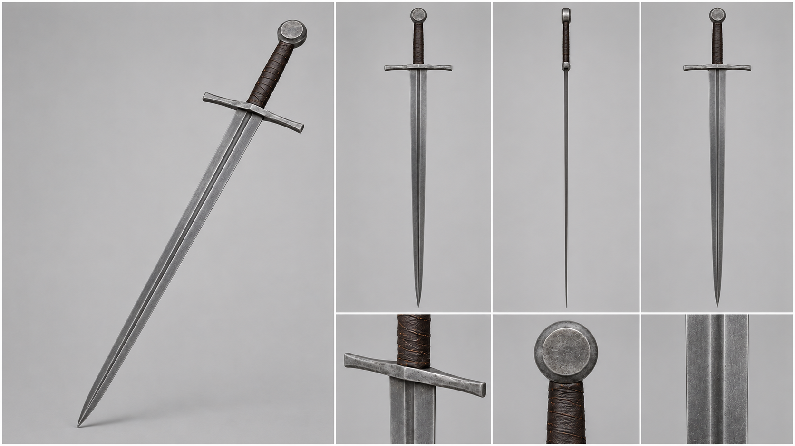
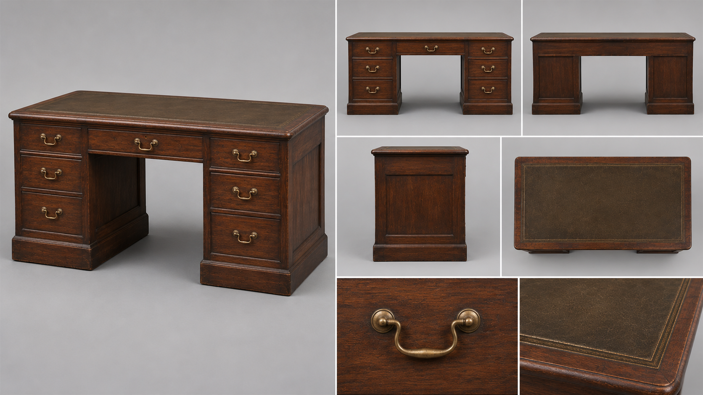
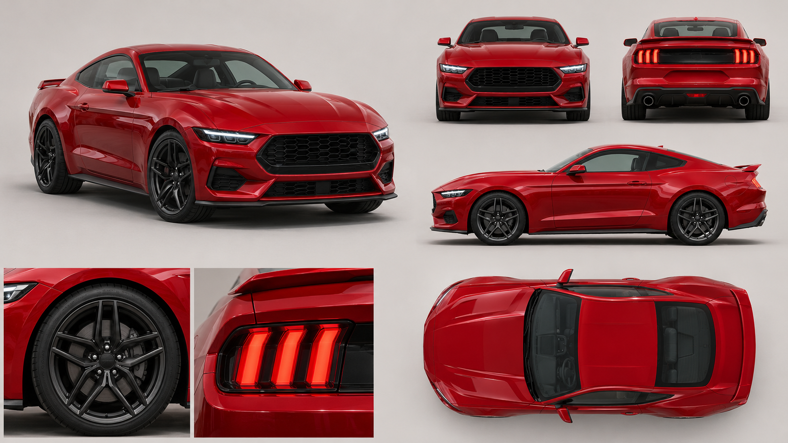

# Catálogo de blueprints

## Cómo guiar al usuario

1. Si no ha elegido formato, muestra los ejemplos existentes de la categoría que pide, con una frase sobre su utilidad. Si pide todos, muestra los ocho. No generes nuevas imágenes para enseñar el menú.
2. Deja que elija por número, nombre o descripción. Conserva los códigos históricos: 4 para objetos y 5 para la ficha compacta.
3. Una vez elegido, ofrece «solo prompt», «solo imagen» o «prompt e imagen» si todavía no lo ha indicado. No repitas elecciones resueltas; «hazme la imagen de este tipo» ya autoriza imagen.
4. Adapta la plantilla enlazada al sujeto y sus referencias. Solo pregunta por datos que realmente falten. Si delega el diseño, decide y continúa.
5. Entrega según la opción y las herramientas disponibles. Traduce explicaciones al idioma del usuario; no incrustes textos en los ejemplos. Si solo pide prompt, no generes. Si pide ambos, entrega el prompt completo y la imagen.

Son fichas de referencia visual, no planos de ingeniería ni medidas verificadas. Las imágenes ilustran el formato; no garantizan que cada detalle generado sea una especificación exacta. Comprueba cada nueva generación antes de presentarla como consistente.

## 1A — Rostro

[Prompt base de este formato](blueprints/rostro.md).

## 1B — Cuerpo y vestuario

[Prompt base de este formato](blueprints/vestuario.md).

## 2 — Personaje completo

[Prompt base de este formato](blueprints/personaje-completo.md).

## 3 — Ficha maestra

[Prompt base de este formato](blueprints/ficha-maestra.md).

## 5 — Ficha compacta

[Prompt base de este formato](blueprints/ficha-compacta.md).

## 4A — Objeto: espada

[Prompt base de este formato](blueprints/objeto-espada.md).

## 4B — Objeto: mueble

[Prompt base de este formato](blueprints/objeto-mueble.md).

## 4C — Objeto: vehículo

[Prompt base de este formato](blueprints/objeto-vehiculo.md).

Para objetos distintos utiliza [la base general](blueprint-objetos.md). Para escenarios usa [las plantillas de escenas](personajes-escenarios-storyboards.md); no ofrezcas un ejemplo visual que no exista.
