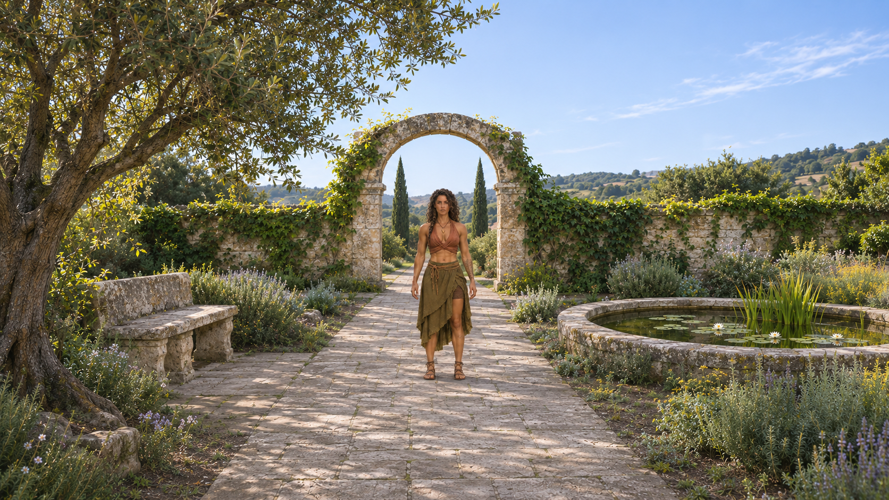
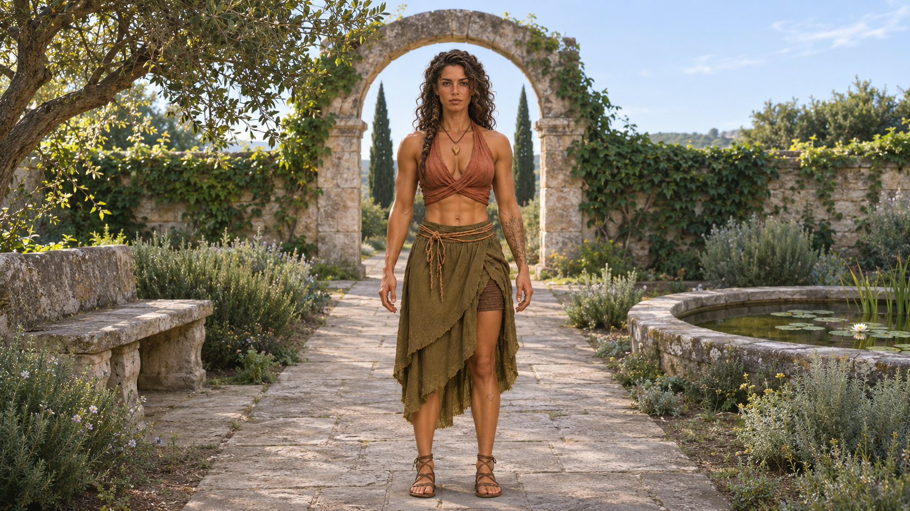
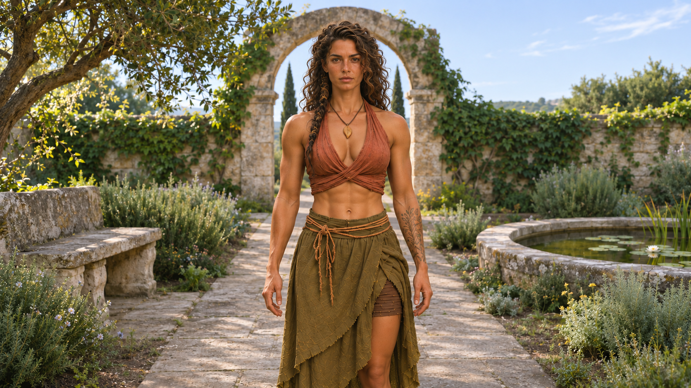
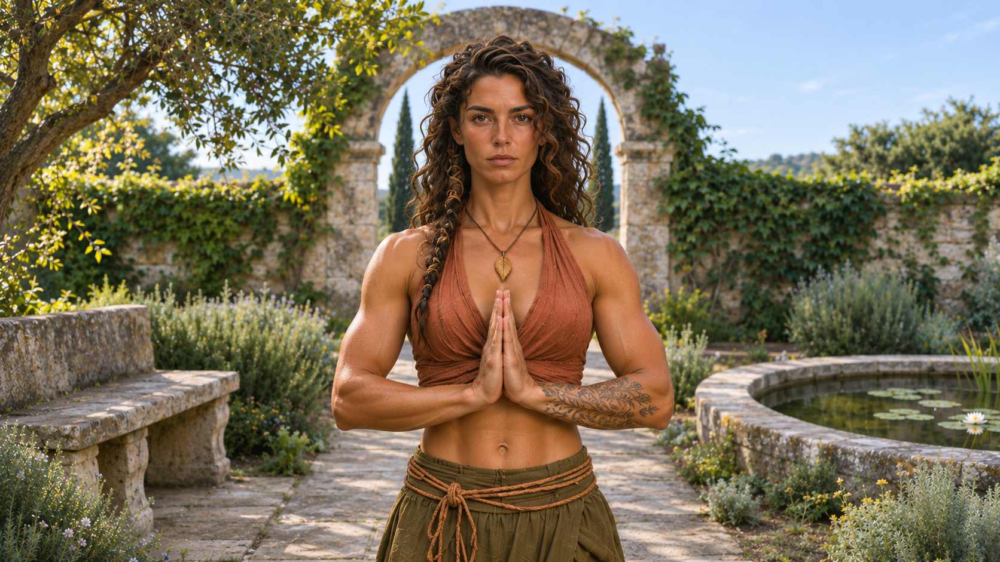
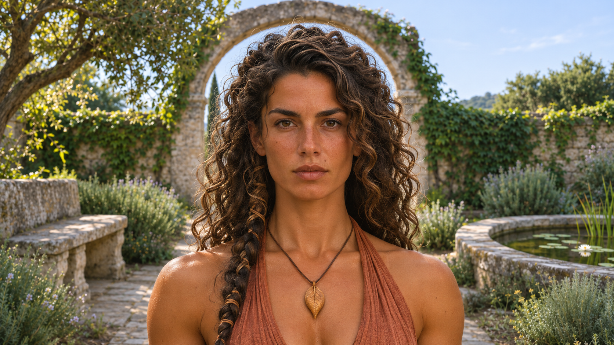
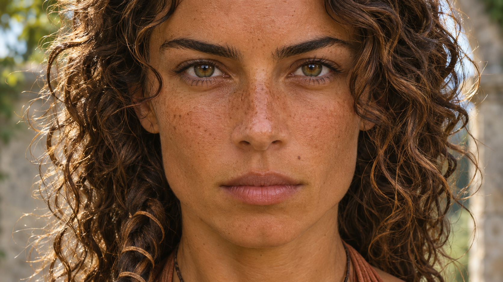
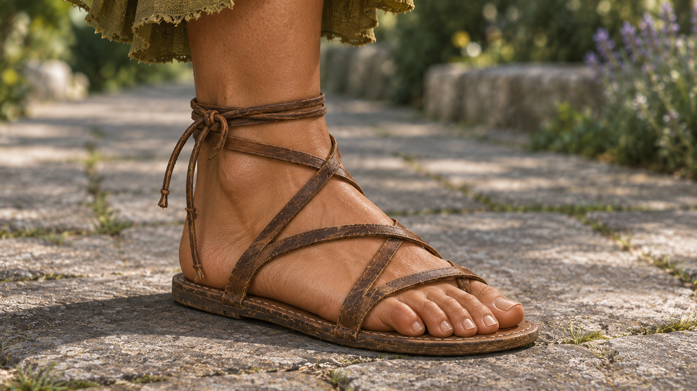

# Planos y encuadres

El tamaño de plano indica cuánto vemos del personaje o del entorno. No determina por sí solo el ángulo ni la lente.

GRAN PLANO GENERAL
El entorno domina y el personaje ocupa una parte pequeña. Sirve para presentar un lugar, mostrar una distancia o sugerir aislamiento.
Prompt: «Gran plano general de una viajera diminuta dentro de un valle inmenso».
Imagen: 

PLANO GENERAL
Muestra al personaje dentro de un entorno reconocible. Ayuda a entender dónde ocurre la acción.
Prompt: «Plano general de la protagonista junto al estanque, con el jardín visible a su alrededor».
Imagen: 

PLANO ENTERO
Incluye al personaje de la cabeza a los pies. Resulta útil para ver su postura, vestuario o acción corporal.
Prompt: «Plano entero de la protagonista, con la cabeza y los pies dentro del encuadre».
Imagen: 

PLANO AMERICANO
Encuadra aproximadamente hasta la zona de las rodillas. Permite mostrar el rostro, las manos y buena parte del cuerpo.
Prompt: «Plano americano de la protagonista mientras sostiene una linterna a la altura de la cintura».
Imagen: 

PLANO MEDIO
Encuadra aproximadamente hasta la cintura. Equilibra expresión y gestos.
Prompt: «Plano medio de la protagonista explicando algo con pequeños movimientos de las manos».
Imagen: 

PLANO MEDIO CORTO
Encuadra aproximadamente hasta el pecho. Da mayor protagonismo a la expresión.
Prompt: «Plano medio corto, expresión atenta y hombros relajados».
Imagen: 

PRIMER PLANO
Se concentra en el rostro y suele incluir parte de los hombros. Permite observar una reacción.
Prompt: «Primer plano del rostro al descubrir una luz al fondo del pasillo».
Imagen: 

PRIMERÍSIMO PRIMER PLANO
El rostro ocupa casi todo el encuadre y puede quedar parcialmente recortado. Intensifica la atención en pequeños cambios de expresión.
Prompt: «Primerísimo primer plano, ojos atentos y labios inmóviles».
Imagen: 

PLANO DETALLE
Aísla una parte concreta de una persona u objeto que importa para la escena.
Prompt: «Plano detalle de las correas de una sandalia sobre el camino de piedra».
Imagen: 

Los límites entre tamaños de plano son aproximados. Describe qué partes deben quedar dentro de la imagen si necesitas precisión.