# Ángulos y puntos de vista

El ángulo describe desde qué altura e inclinación observa la cámara. La orientación frontal, lateral o posterior describe otra decisión: qué lado del personaje vemos.

ÁNGULO NORMAL
Mirada aproximadamente a la altura de los ojos, sin inclinación marcada. Suele ofrecer una relación directa con el personaje.
Prompt: «Cámara a la altura de los ojos, horizonte nivelado».
Imagen: 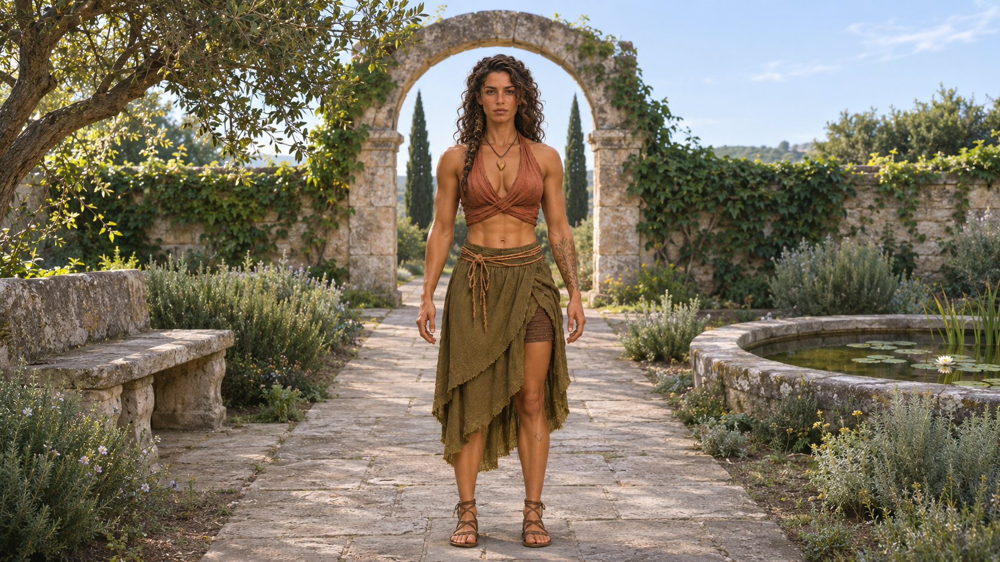

PICADO
La cámara está por encima y mira hacia abajo. Permite mostrar la relación con el suelo o el entorno; según el contexto, puede sugerir vulnerabilidad.
Prompt: «Picado desde una posición elevada, mostrando el camino alrededor de ella».
Imagen: 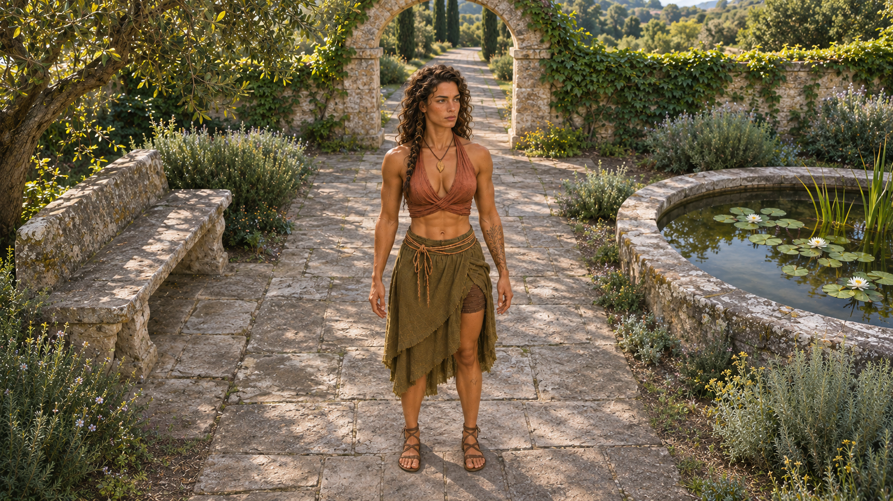

CONTRAPICADO
La cámara está por debajo y mira hacia arriba. Puede reforzar presencia, altura o amenaza.
Prompt: «Contrapicado desde una posición baja, con los árboles elevándose detrás».
Imagen: 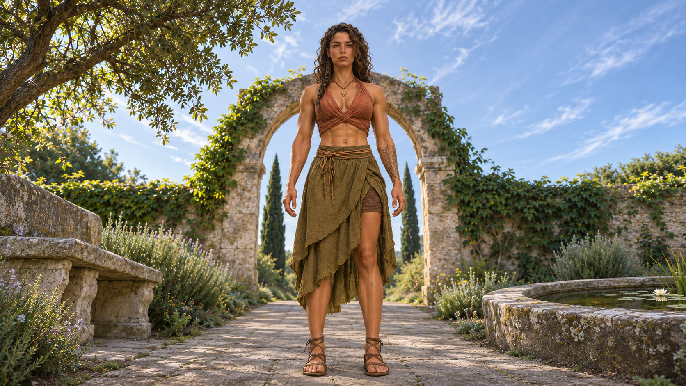

ZENITAL
La cámara mira verticalmente hacia abajo. Hace visible la distribución de personas y objetos sobre el suelo.
Prompt: «Vista zenital perpendicular al suelo, protagonista en el centro del sendero».
Imagen: 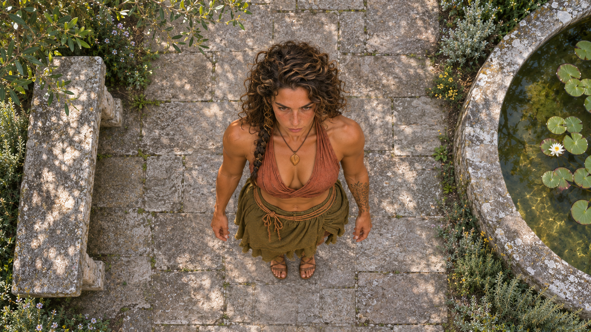

NADIR
La cámara mira verticalmente hacia arriba. Es un punto de vista extremo que muestra al personaje y lo que hay por encima.
Prompt: «Cámara a ras de suelo, junto a sus pies, apuntando verticalmente al cielo».
Imagen: 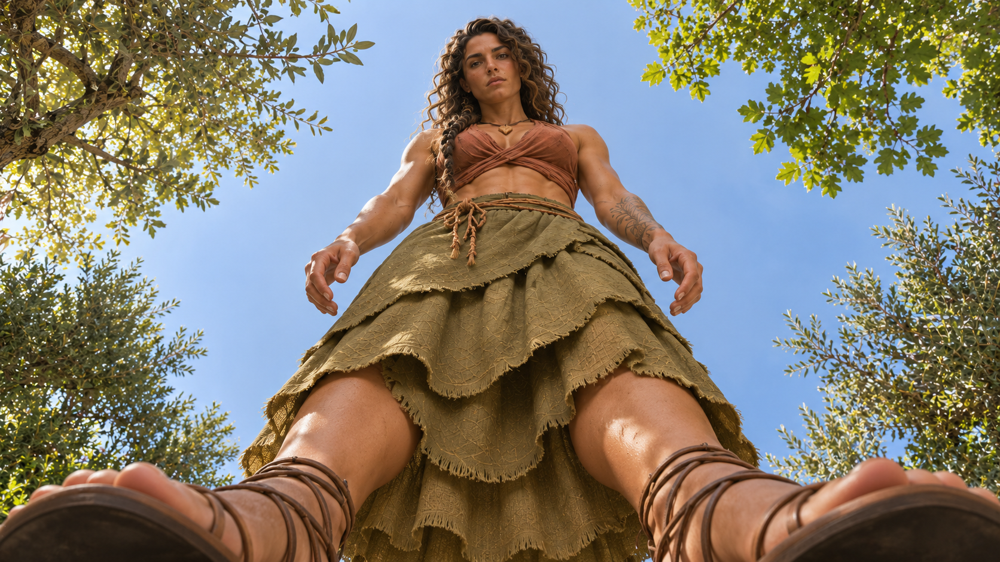

ÁNGULO HOLANDÉS
La cámara se inclina sobre su eje y las líneas que normalmente serían horizontales aparecen diagonales. Puede expresar inestabilidad.
Prompt: «Encuadre inclinado lateralmente, con todo el entorno y el personaje afectados por la misma inclinación».
Imagen: 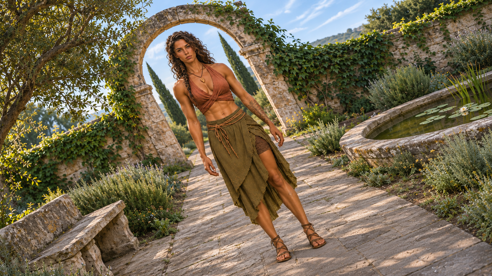

VISTA AÉREA OBLICUA
Vista elevada en diagonal, como la que puede obtener un dron. No es necesariamente zenital ni implica que la cámara se esté moviendo.
Prompt: «Vista aérea oblicua del jardín, con el personaje pequeño y el recorrido del camino visible».
Imagen: 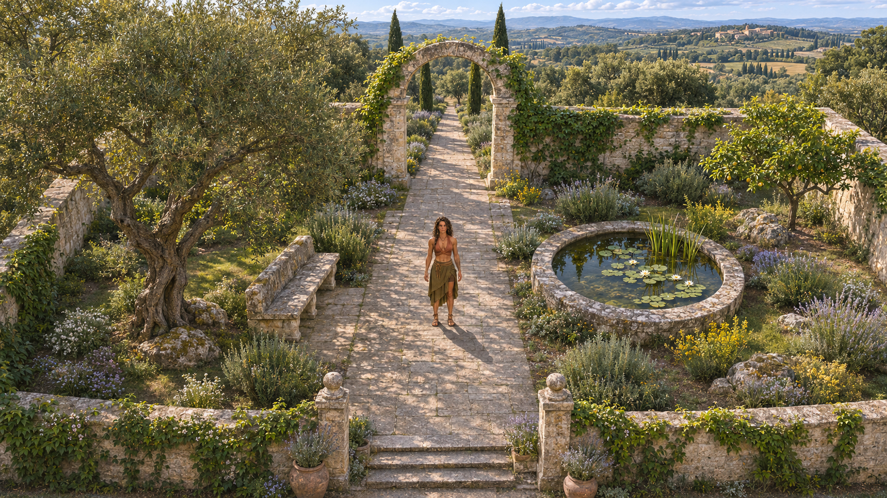

SOBRE EL HOMBRO
Incluye parte de la cabeza o del hombro en primer término y muestra aquello que el personaje observa.
Prompt: «Plano sobre el hombro de la protagonista, mirando hacia una puerta cerrada».
Imagen: 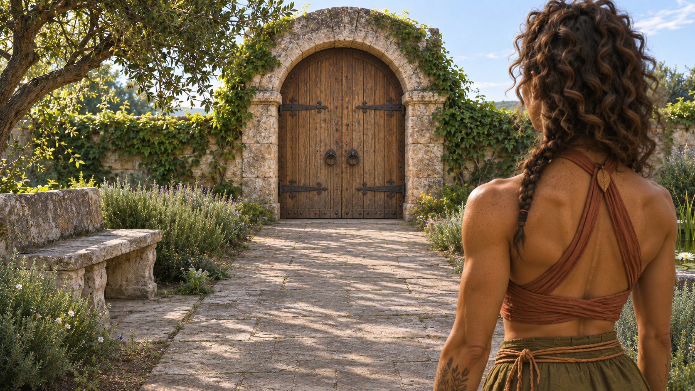

PLANO SUBJETIVO
Adopta lo que ve el personaje. Sus manos pueden aparecer, pero no es obligatorio.
Prompt: «Vista desde los ojos de la protagonista; sus manos empujan una puerta de madera».
Imagen: 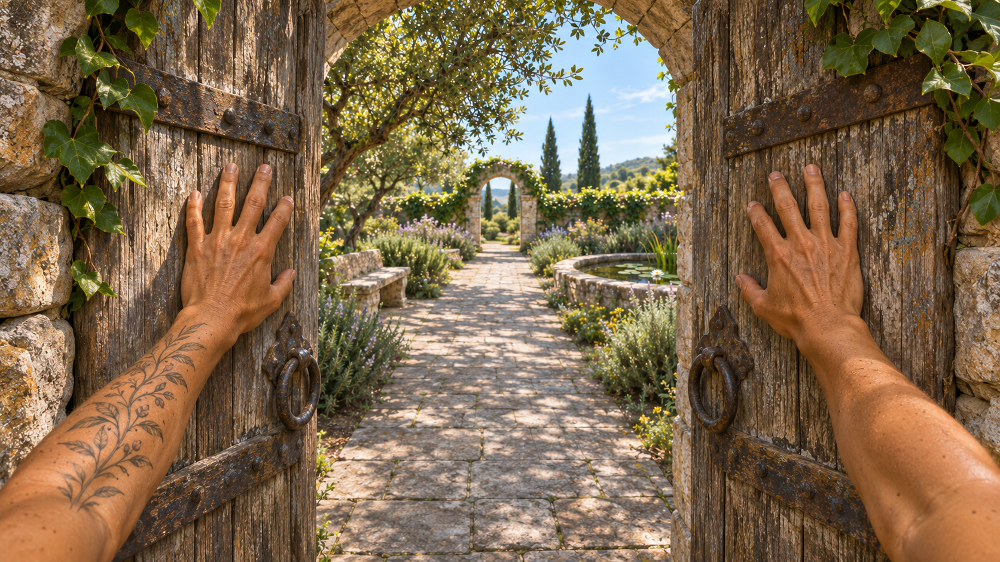

ORIENTACIONES
Frontal: vemos al personaje de frente. Perfil: lo vemos de lado. Tres cuartos: una orientación intermedia. Posterior: lo vemos de espaldas.
Prompt: «Vista de perfil, rostro y cuerpo orientados hacia la izquierda del encuadre».
Imágenes: 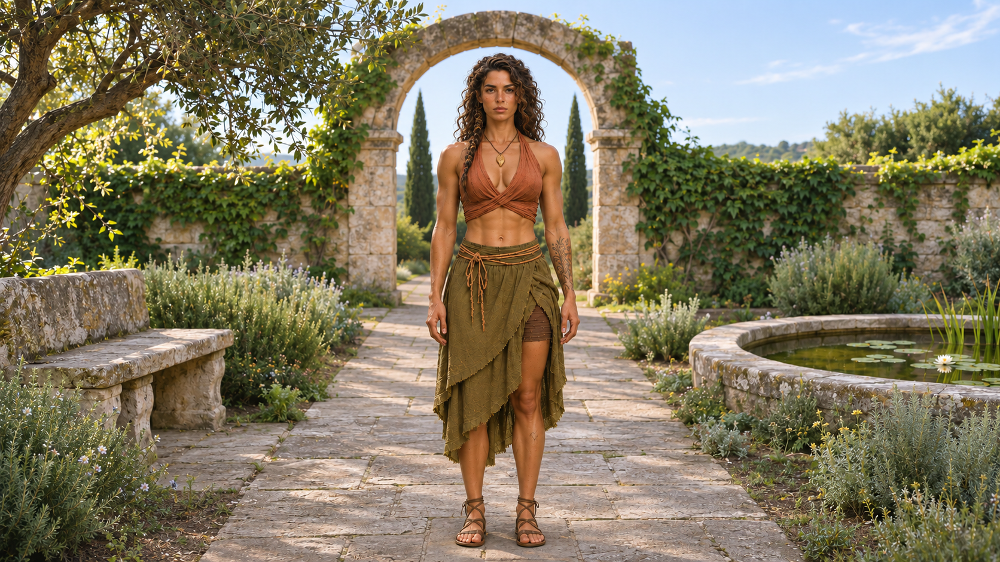, 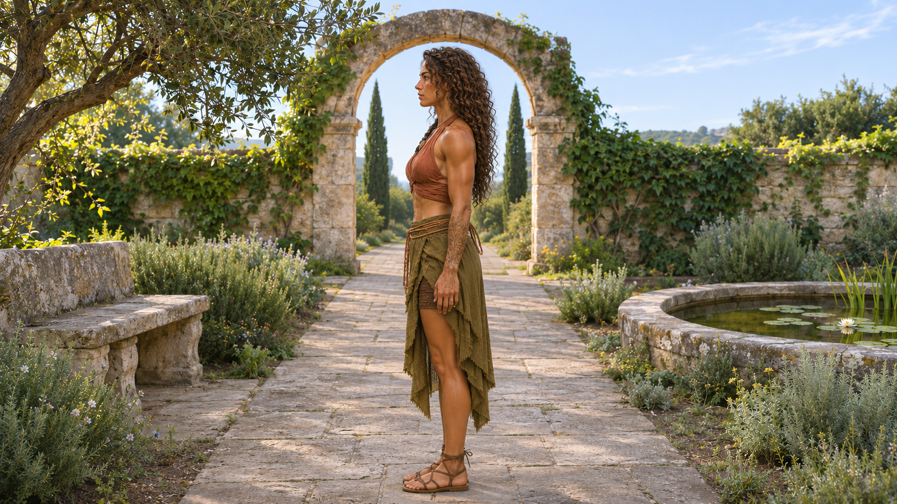, 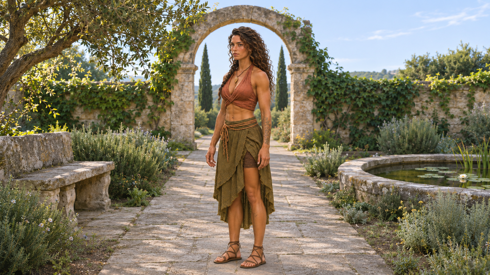, 