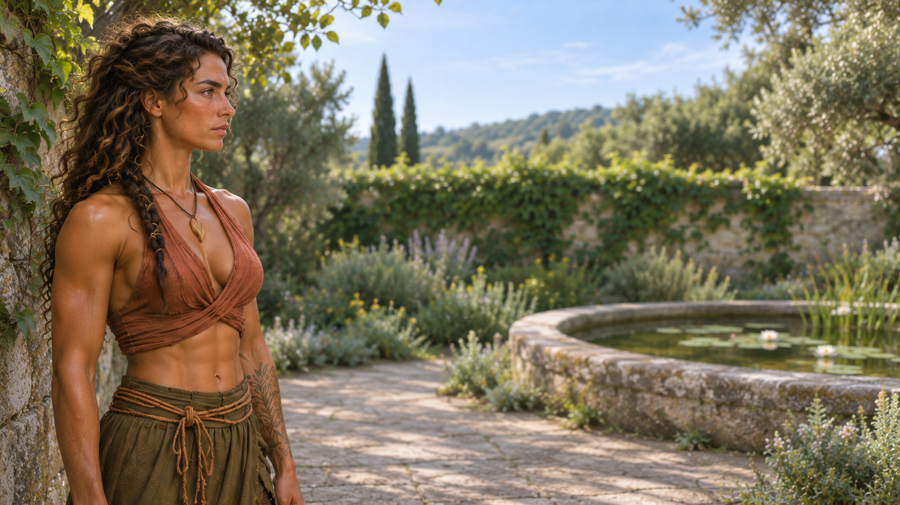

# Composición

La composición organiza la atención dentro del encuadre. Estas herramientas son opciones expresivas, no reglas que deban cumplirse siempre.

REGLA DE LOS TERCIOS
Imagina la imagen dividida en tres partes horizontales y tres verticales. Sitúa elementos importantes cerca de esas líneas o sus cruces para explorar un equilibrio descentrado.
Prompt: «Protagonista cerca del tercio izquierdo; el entorno equilibra el resto del encuadre».
Imagen: 

SIMETRÍA
Distribuye elementos de forma equilibrada a ambos lados de un eje. Puede sugerir orden, solemnidad o rigidez.
Prompt: «Composición simétrica, protagonista centrada y elementos arquitectónicos equilibrados a ambos lados».
Imagen: 

ESPACIO DE MIRADA
Deja espacio delante de la dirección en que mira el personaje.
Prompt: «Protagonista a la izquierda, mirando hacia el espacio libre situado a la derecha».
Imagen: 

ESPACIO DE MOVIMIENTO
Deja espacio delante del recorrido del personaje. En una imagen fija, una postura de marcha permite mostrar esta decisión de encuadre.
Prompt: «Figura caminando hacia la derecha, con espacio amplio por delante dentro del encuadre».
Imagen: 

LÍNEAS DE FUGA
Los bordes de un camino, paredes u otros elementos que se alejan pueden dirigir la mirada hacia una zona importante. Las líneas que guían la atención no siempre tienen que converger.
Prompt: «Los bordes del camino convergen visualmente hacia la protagonista».
Imagen: 

MARCO DENTRO DEL MARCO
Una puerta, ventana o arco encuadra al sujeto dentro de la propia escena.
Prompt: «La protagonista aparece enmarcada por una puerta de piedra en primer término».
Imagen: 

AIRE SOBRE LA CABEZA
Es el espacio entre la cabeza y el borde superior. Evita dejar una franja excesiva sin intención; en planos muy cerrados puede ser deliberado recortar parte del cabello.
Prompt: «Plano medio corto con un espacio moderado sobre la cabeza».
Referencia disponible: 