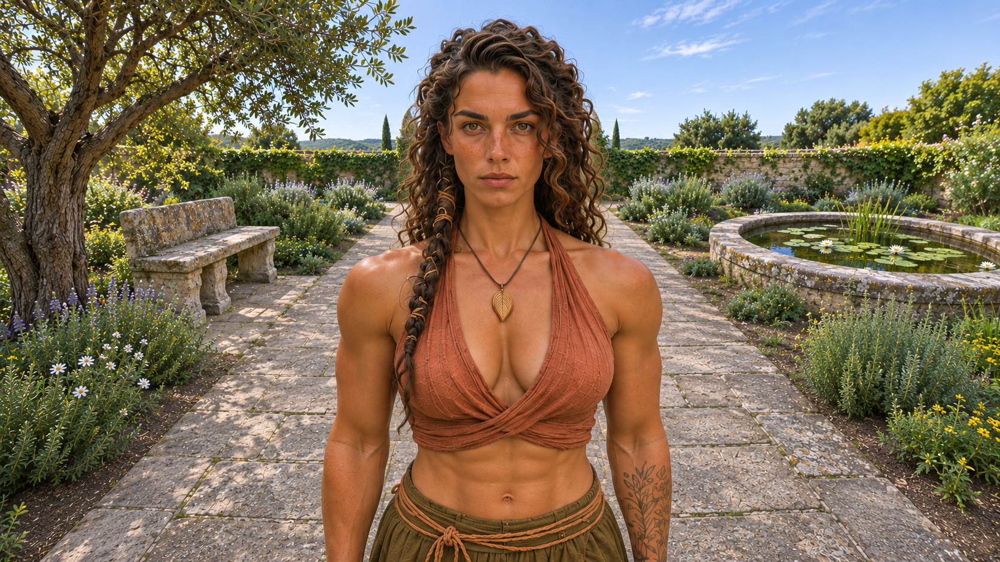
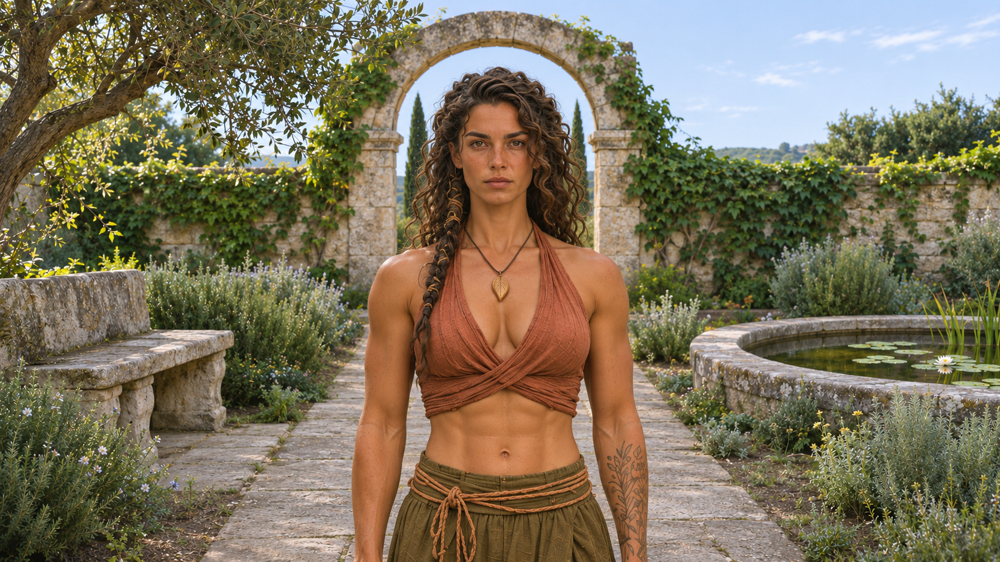
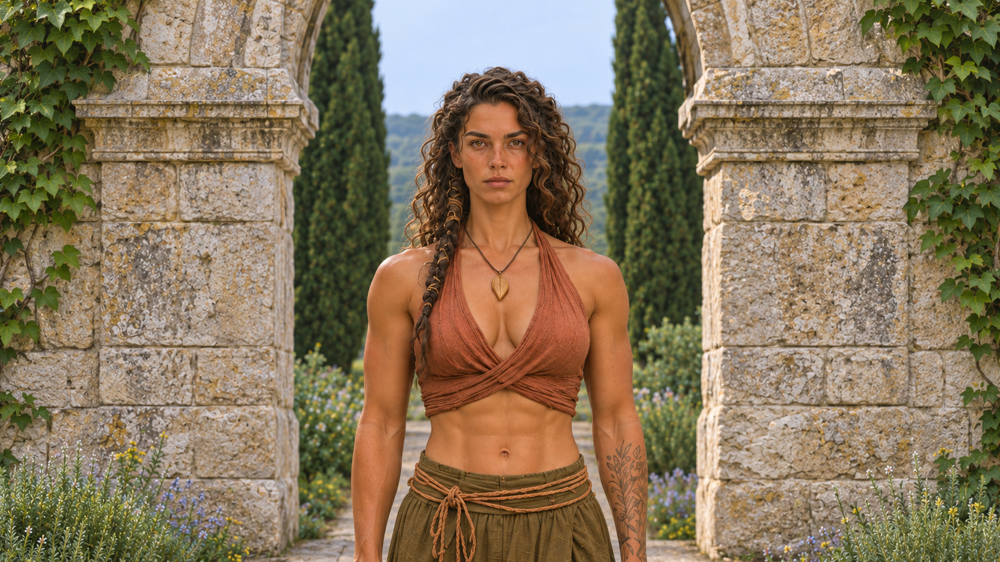

# Lentes y enfoque

Conviene separar tres decisiones: la focal, la distancia de la cámara y el enfoque.

La focal influye en cuánto abarca el encuadre. La perspectiva depende de la posición de la cámara: al acercarla cambian las proporciones aparentes entre lo cercano y lo lejano. Por eso, al comparar lentes manteniendo un tamaño parecido del personaje, también debemos considerar que se ha cambiado la distancia.

GRAN ANGULAR
Abarca un campo amplio. Cerca del personaje puede acentuar la diferencia entre las partes próximas y el fondo.
Prompt: «Gran angular con la cámara cerca, entorno amplio y profundidad marcada».
Imagen: 

FOCAL NORMAL
Ofrece un campo de visión intermedio. No existe un único número de milímetros válido para todos los formatos de cámara.
Prompt: «Perspectiva moderada, cámara a una distancia cómoda y proporciones naturales».
Imagen: 

TELEOBJETIVO
Abarca un campo más estrecho. Al alejar la cámara para conservar el tamaño del sujeto, las diferencias aparentes de tamaño entre distancias se reducen.
Prompt: «Teleobjetivo desde lejos, protagonista encuadrada de cintura hacia arriba y fondo aparentemente más próximo».
Imagen: 

Las tres imágenes ilustran el efecto combinado de focal y distancia de cámara, con un tamaño parecido del personaje. Son ejemplos generados, no una simulación óptica calibrada ni focales medidas.

PROFUNDIDAD DE CAMPO
Es la zona que percibimos suficientemente nítida por delante y por detrás del punto enfocado. Depende de varios factores, entre ellos apertura, focal y distancias.

Mayor profundidad: permite leer al personaje y buena parte del entorno.
Prompt: «Protagonista nítida y jardín del fondo también reconocible y definido».
Imagen: 

Menor profundidad: separa al personaje de un fondo desenfocado.
Prompt: «Ojos enfocados, fondo suavemente desenfocado».
Imagen: 

CAMBIO DE FOCO
Desplaza la atención entre elementos a distinta distancia. Es una acción temporal; se explica con texto, sin una imagen de movimiento.
Prompt: «La cámara permanece fija. El foco pasa suavemente de la llave en primer término al rostro situado detrás».