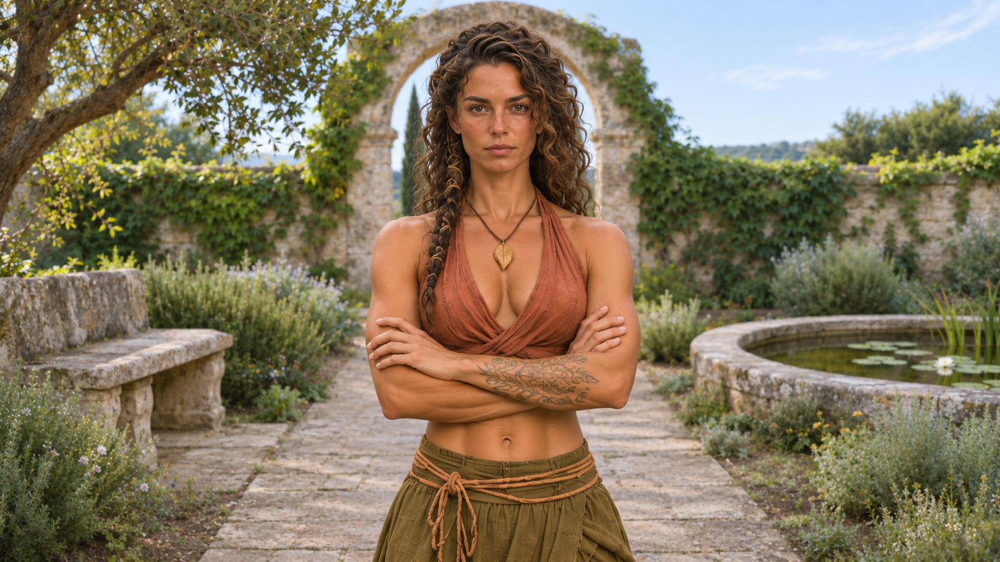
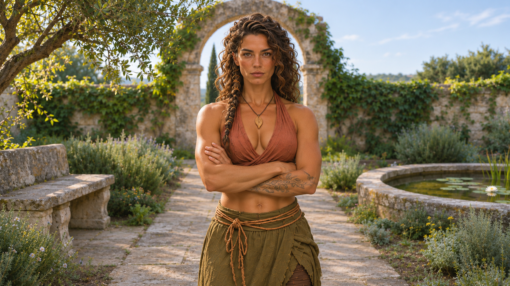
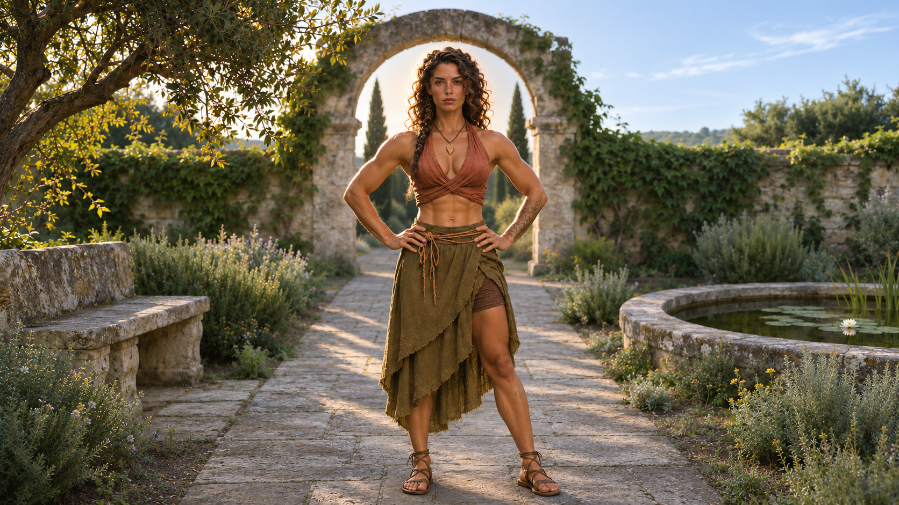
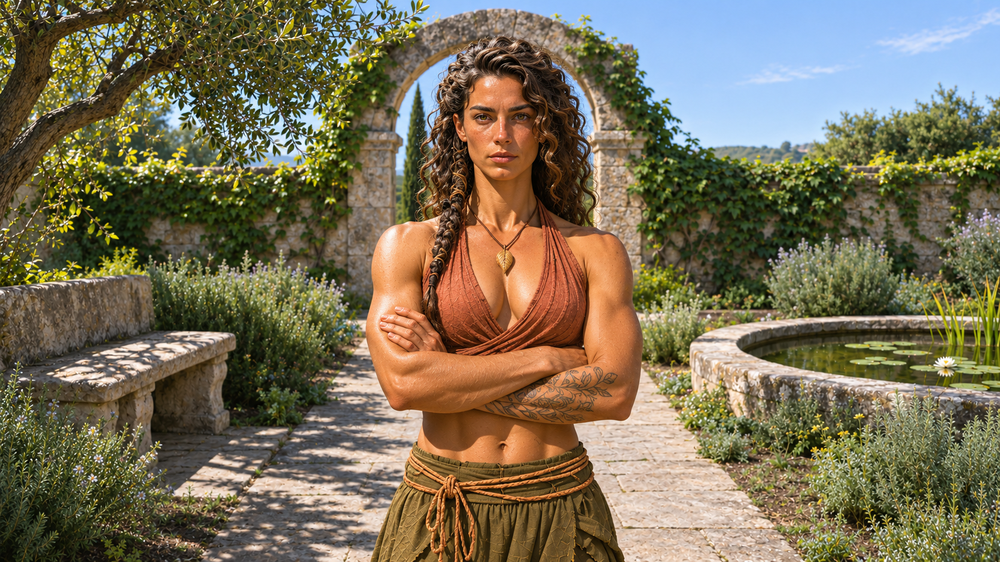
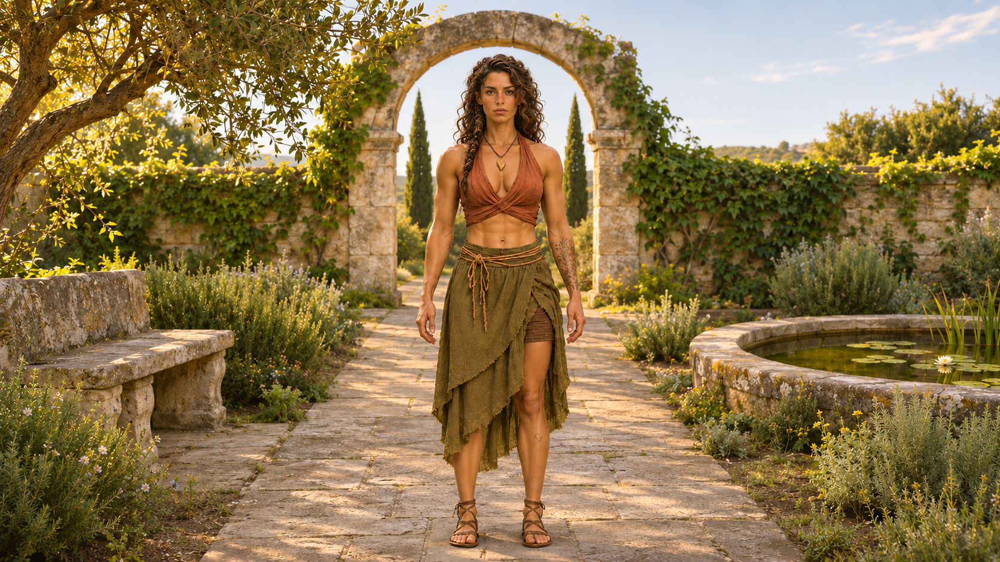
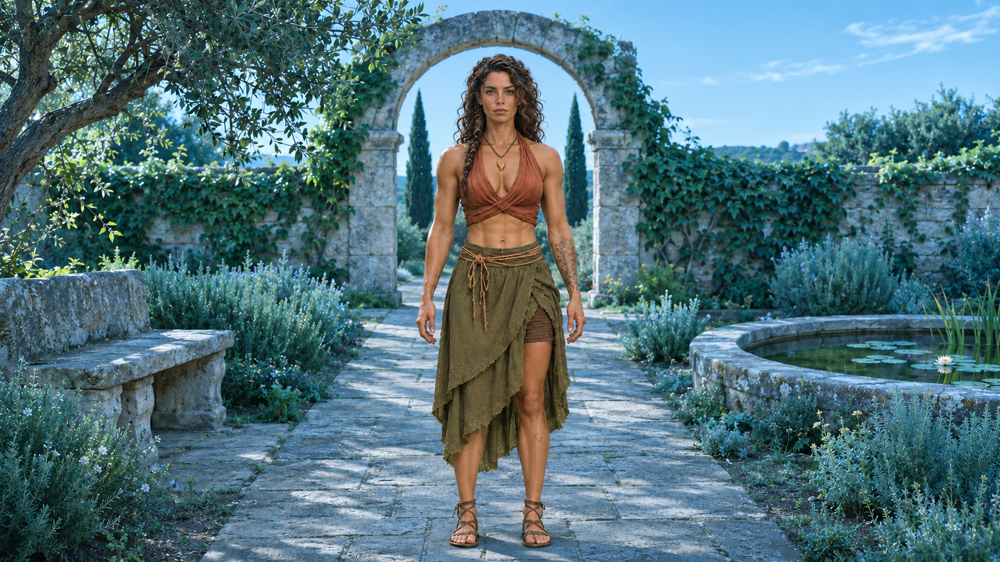

# Iluminación y color

La dirección de la luz y su dureza son decisiones diferentes: una luz lateral también puede ser suave o dura.

LUZ FRONTAL SUAVE
Llega desde una dirección próxima a la cámara y produce transiciones suaves en las sombras. Facilita ver el rostro.
Prompt: «Luz frontal amplia y suave, sombras delicadas».
Imagen: 

LUZ LATERAL
Ilumina principalmente desde un lado. Ayuda a describir el volumen del rostro y las texturas.
Prompt: «Luz lateral desde la izquierda del encuadre, con sombra gradual en el lado opuesto».
Imagen: 

CONTRALUZ
La fuente principal se sitúa detrás del sujeto respecto a la cámara. Puede crear un contorno luminoso; el rostro puede conservar detalle mediante luz de relleno.
Prompt: «Contraluz que resalta los rizos, rostro visible con relleno suave».
Imagen: 

LUZ DURA
Genera sombras de bordes definidos, como las del sol directo en determinadas condiciones.
Prompt: «Sol directo, sombras marcadas bajo la nariz y el mentón».
Imagen: 

COLOR CÁLIDO
Predominan amarillos, dorados o ámbar. Su efecto emocional depende de la historia: no siempre significa alegría.
Prompt: «Tratamiento de color cálido, tonos dorados y piel natural».
Imagen: 

COLOR FRÍO
Predominan azules o cian. Puede reforzar una atmósfera serena, distante o inquietante según el contexto.
Prompt: «Tratamiento de color frío en el entorno, conservando la piel reconocible».
Imagen: 

LUZ NATURAL Y ARTIFICIAL
Natural describe una fuente como el sol o el cielo; artificial, una lámpara u otra fuente creada. Ninguna es necesariamente suave, dura, cálida o fría.
Describe la fuente y su dirección: «Luz de una ventana a la derecha» es más útil que pedir únicamente «iluminación cinematográfica».

CONTINUIDAD DE LUZ
Si una escena continúa en el mismo lugar y momento, conserva la dirección de la fuente, la exposición y el ambiente entre planos, salvo que la historia justifique un cambio.