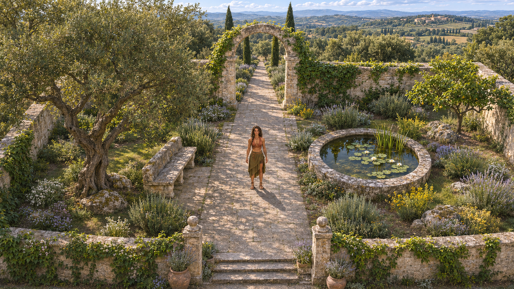

# Cámaras y soportes

Para preparar un prompt, suele ser más útil describir el resultado que mencionar una marca de cámara.

TIPOS DE CÁMARA
Un móvil, una cámara sin espejo o una cámara de cine pueden producir resultados distintos según su óptica, configuración, iluminación y uso. El nombre del equipo no garantiza por sí solo un aspecto visual concreto.

TRÍPODE
Mantiene la cámara apoyada y permite planos fijos o giros controlados.
Prompt: «Cámara fija sobre trípode, encuadre estable durante toda la acción».

CÁMARA EN MANO
La sostiene una persona; puede transmitir cercanía o urgencia. No tiene por qué temblar exageradamente.
Prompt: «Cámara en mano con pequeñas variaciones orgánicas, sujeto legible».

GIMBAL O ESTABILIZADOR
Ayuda a suavizar movimientos al desplazar la cámara.
Prompt: «Seguimiento fluido a la altura del pecho, desplazamiento estabilizado».

DOLLY O CARRO
Permite desplazar físicamente la cámara con un recorrido controlado, a menudo sobre una superficie preparada o raíles.
Prompt: «Acercamiento recto y uniforme de la cámara hacia el personaje».

GRÚA O JIB
Permite variar la altura y describir arcos de movimiento.
Prompt: «La cámara asciende progresivamente y descubre el jardín detrás del personaje».

DRON
Es una plataforma aérea. Puede mostrar paisajes desde altura, mantenerse quieto o recorrer un espacio. Una vista aérea no exige necesariamente movimiento.
Prompt: «Vista aérea oblicua estable, mostrando la distribución del jardín».
Referencia visual del punto de vista: 

Estos ejemplos describen una intención de puesta en escena; no certifican qué equipo se utilizó para crear una imagen. Los soportes y movimientos se explican con texto.